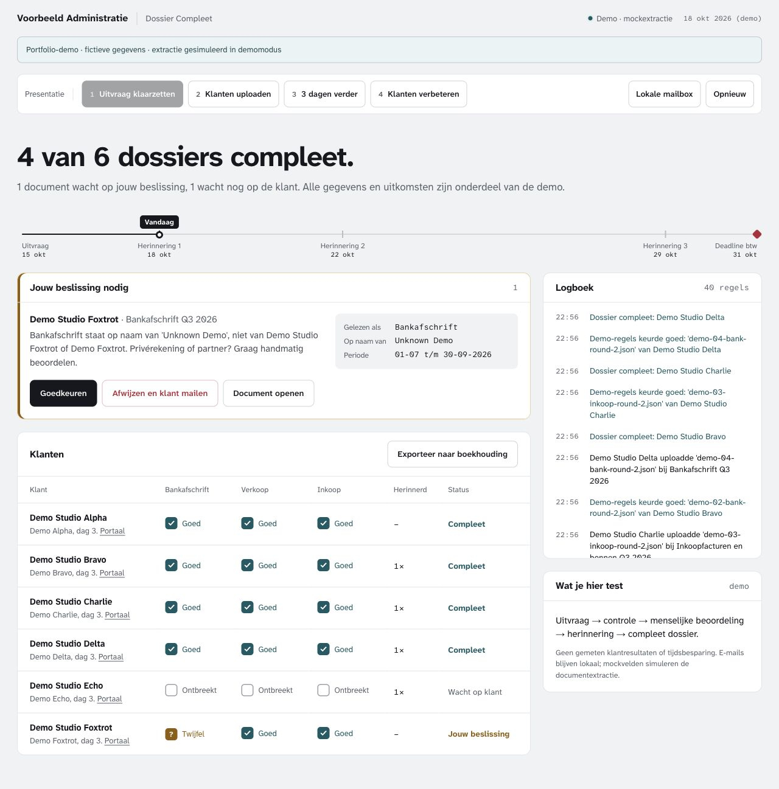
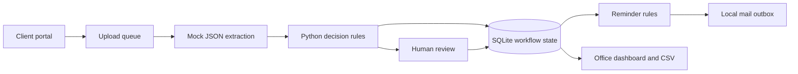

# Dossier Compleet

**A local document-collection workflow that turns missing paperwork into clear next steps.**

A portfolio project by Karim, a first-year AI student at Vrije Universiteit Amsterdam. Built together with an AI coding assistant (see [How I worked on this](#how-i-worked-on-this)); adapted from my existing automation project.



## The problem

An administrative office needs to know which quarterly documents are missing, which uploads need correction, and when a person should take over. A shared inbox makes that state difficult to follow.

## What it does

- Creates a quarterly request and a separate upload link for each mock client.
- Checks document type, name, period and readability using explicit decision rules.
- Routes uncertain cases to a human, records decisions, and exports accepted entries as CSV.
- Runs reminders using a demo clock and flags cases that need a call.
- Saves HTML emails as local `.eml` files, viewable in an in-app mailbox. This copy cannot send email.

**The default demo simulates extraction using generated JSON fixtures. It does not read a real PDF with AI.** An optional local Ollama/PDF adapter remains in the source, separate from the rule engine.

## Run the demo

Requires Python 3.11 or newer. The default mode uses only the Python standard library: no packages, keys, Ollama or Mailpit are needed.

```bash
python3 tools/run_demo.py
```

Open <http://127.0.0.1:8787/kantoor> (the interface is in Dutch). If the port is in use, run `python3 tools/run_demo.py --port 8797` and use that port in your browser.

1. Click **Uitvraag klaarzetten** to prepare mock requests and local messages.
2. Click **Klanten uploaden** to exercise valid uploads, the wrong quarter, an unreadable receipt, a wrong document type and a name requiring review.
3. Move the demo clock forward to exercise reminders; inspect **Lokale mailbox**.
4. Click **Klanten verbeteren**, make the remaining review decision, and open a client's **Portaal**.
5. Export the accepted mock entries as CSV. One mock client deliberately does not respond, so reminders remain visible.

To upload manually in demo mode, select a generated `.json` fixture from `.demo/dossier/demo_docs/`. All fixture fields, amounts, identities and scenario outcomes are synthetic.

The date labels refer to the fixed Q3 2026 scenario. Generated state lives in ignored `.demo/`. The reset button replaces the generated database and uploads after confirmation; old mailbox files are retained.

## Architecture



The model reads fields in the optional adapter; the decision rules own accept/reject/review outcomes. The default JSON reader lets someone inspect that workflow without model setup.

## Tech stack

Python, SQLite, the standard-library HTTP server, HTML, CSS and JavaScript. Local Atkinson fonts are included with their original SIL Open Font License notice.

## Verification

```bash
python3 tools/test_dossier_rules.py
python3 tools/test_workflow.py
```

Verified during preparation: **19 decision-rule scenarios and 4 workflow integration tests passed** on Python 3.14.7, including a re-run from a clean copy of this repository. Browser checks covered the dashboard, reminders, corrected mock uploads and the client portal. Desktop and 390px mobile layouts were inspected.

The optional model path has **not** been exercised in this preparation. It needs an already installed Ollama vision model and macOS tools (`swiftc`/PDFKit and `sips`). Installations are not performed by the demo launcher. Its current PDF sampling and extraction behavior need further evaluation.

## How I worked on this

I built this together with an AI coding assistant. I decided what the workflow should do, then read, ran and tested what we produced. These are the design choices I can explain:

- **Rules decide, extraction only reads.** Reading a document and accepting it are separate steps, so the accept / reject / review outcomes can be tested without a model.
- **Uncertain cases go to a person.** A name, period or reading that doesn't clearly match is routed to human review instead of being guessed.
- **Reminders run on a demo clock.** The reminder and escalation logic can be exercised in seconds instead of waiting days.
- **Mock extraction is labelled as mock.** The default demo uses JSON fixtures, so nobody mistakes it for measured AI accuracy.

## Lessons learned

- Keep document extraction separate from rules so decisions remain testable.
- Use a human review state when a name, period or reading is uncertain.
- Make fixture extraction and real model extraction visibly different.
- Test mock identities too: shared words in names can weaken fuzzy matching.

## What I would improve next

Add authenticated office access, safer concurrent state changes, upload format validation, structured model-output validation, and cross-platform PDF handling. Evaluate extraction on a properly sourced synthetic dataset before making accuracy claims.

This is a loopback-only learning demo, not a deployed accounting service. No client use, time savings, model accuracy or business results are claimed. The snapshots show synthetic scenario states.

## License

[MIT](LICENSE). Third-party font notices: [`tools/dossier_web/atkinson-OFL.txt`](tools/dossier_web/atkinson-OFL.txt).
